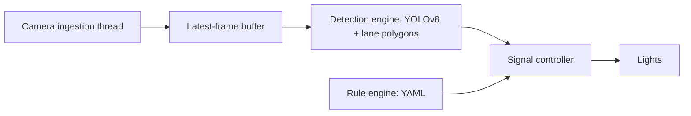

# 🚦 Traffic Light Optimisation System

A real-time computer vision pipeline that counts queueing vehicles per lane with YOLOv8 and adjusts signal timings to match.

**Role focus:** AI Engineer · **Stack:** Python, YOLOv8 (Ultralytics), OpenCV, NumPy, YAML rule engine, pytest



Design decisions are in [docs/ARCHITECTURE.md](docs/ARCHITECTURE.md).

## Measured results

**Vision** (YOLOv8n at 640x640, Apple M2, 200 unseen synthetic frames):

| Detector | p50 | p95 | p99 | Max | Count error |
|---|---:|---:|---:|---:|---:|
| YOLOv8n, CPU | 40.9 ms | 54.7 ms | 62.4 ms | 65.2 ms | 0 of 4,768 |
| YOLOv8n, M2 GPU | 14.5 ms | 15.0 ms | 18.3 ms | 37.5 ms | 0 of 4,768 |
| OpenCV contours, CPU | 12.6 ms | 13.0 ms | 13.4 ms | 13.8 ms | 39 of 4,768 |

In the threaded pipeline at 15 fps on the CPU, capture to controller update took 55 ms at p95. YOLOv8n was trained from scratch on 300 synthetic images for 25 epochs, scoring 0.995 mAP50 and 0.843 mAP50-95 on 60 validation images from a separate random stream.

**Signals** (20 simulated hours per scenario, identical traffic for both, 30 s fixed greens):

| Scenario | Fixed veh/h | Adaptive veh/h | Throughput (95% CI) | Mean delay, fixed | Mean delay, adaptive | Delay change |
|---|---:|---:|---:|---:|---:|---:|
| quiet | 712 | 715 | +0.3% ± 0.2% | 14.5 s | 8.6 s | -40% |
| balanced | 3988 | 3989 | +0.0% ± 0.1% | 20.5 s | 18.0 s | -12% |
| uneven | 3867 | 4386 | +13.4% ± 0.7% | 231.8 s | 17.1 s | -93% |
| tidal | 4725 | 4960 | +5.0% ± 0.3% | 118.9 s | 25.9 s | -78% |
| saturated-uneven | 4273 | 5509 | +28.9% ± 0.5% | 637.6 s | 299.9 s | -53% |
| saturated-balanced | 5739 | 6196 | +8.0% ± 0.1% | 445.8 s | 339.6 s | -24% |

Throughput rises most when traffic is heavy and uneven (+28.9%). In quiet or balanced traffic a fixed cycle already serves everyone, so the gain there is shorter waits. With YOLO in the loop, one saturated-uneven hour served 5,456 vehicles, against 5,500 with perfect counts and 4,289 with fixed signals.

**Read these with care.** All images are synthetic and simple, so the accuracy figures do not predict accuracy on real roads. The simulation models queues only, with no turning traffic or pedestrians. The fixed baseline is an equal split that was not retimed for each scenario; a well-tuned plan would narrow the gap.

## Run it

```bash
python3 -m venv .venv && .venv/bin/pip install -e ".[dev,yolo]"
```
```bash
.venv/bin/traffic-lights run
```
```bash
.venv/bin/traffic-lights evaluate
```

Those use the OpenCV detector, so `[yolo]` is optional. To train and use YOLOv8:

```bash
.venv/bin/traffic-lights train --device mps
```
```bash
.venv/bin/traffic-lights bench --detector yolo
```
```bash
.venv/bin/traffic-lights run --detector yolo
```

`run --source` takes a video file, stream or camera number. Real footage needs COCO YOLOv8 weights (`--weights`) and lane polygons drawn for that camera in `scene.lane_polygons`.

## Rule engine

[config/junction.yaml](config/junction.yaml) sets the timings and the rules that switch between adaptive, peak, quiet and fixed modes. Each rule has a metric, threshold, priority and hold time. If detections stop for 3 seconds, the controller falls back to fixed timing whatever the rules say.

## Tests

54 tests: safe light sequences, green limits in every mode, camera failure, lag under a slow detector, vehicle conservation and vision in the loop.

```bash
.venv/bin/pytest
```

## License

MIT for this code. The optional Ultralytics package is AGPL-3.0, so check its terms before using it in a closed product.
